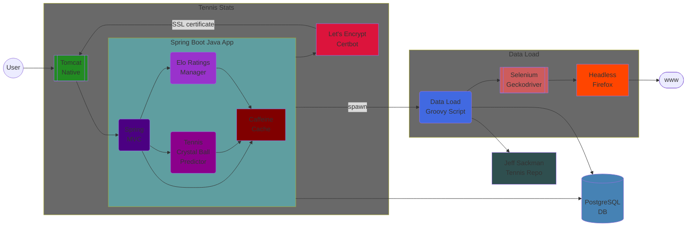

# Ultimate Tennis Statistics and Tennis Crystal Ball

[](https://travis-ci.org/mcekovic/tennis-crystal-ball)
[](https://github.com/mcekovic/tennis-crystal-ball/actions?query=workflow%3Abuild)
[](https://www.ultimatetennisstatistics.com)
[](https://sonarcloud.io/dashboard?id=mcekovic_tennis-crystal-ball)
[](http://www.apache.org/licenses/LICENSE-2.0)
[](https://github.com/mcekovic/tennis-crystal-ball/search?l=java)


**Ultimate Tennis Statistics** is a Tennis Big Data Analysis tool with a nice web GUI.
**Tennis Crystal Ball** is a set of Match Prediction and Tournament Forecasts algorithms powered by AI and machine learning.

## Features

- 'GOAT' List - A.k.a. 'GOATometer' - Best players of Open Era ranked by 'GOAT' points with customizable weights (overall and by surface)
- Player Profile - Player information, season summary, tournament results, matches, timeline, rivalries, ranking, performance indicators and statistics with charts, 'GOAT' points breakdown and records
- Timelines - Dominance ('GOAT' points distribution among top players and seasons), Grand Slam, Tour Finals, Masters, Olympics, Davis Cup, Team Cups, Top Rankings and Surface timeline
- Head-to-Head - Head-to-head between two players with H2H matches, season summary, performance and statistics comparison, ranking, performance and statistics charts, 'GOAT' points breakdown and Hypothetical Matchup prediction based on the Neural Network Match Prediction Algorithm
- Heads-to-Heads - Heads-to-heads clusters among several players (i.e. among 'Big 4')
- Greatest Rivalries - Explore greatest rivalries, overall or by season, tournament level, surface or round
- Greatest Matches - Explore greatest matches ranked by special Match Greatness Score formula
- Ranking Tables - Player weekly ranking tables
- EloRatings - Player weekly [Elo rating](https://en.wikipedia.org/wiki/Elo_rating_system) tables (overall, by surface, outdoor or indoor, set or game) using customized Elo rating formula
- Ranking Charts - Player ranking and ranking point charts, compare players by constructing custom charts
- Peak Elo Ratings - Peak Elo ratings list for comparing players in their peaks (overall, by surface, set, service/return game and tie-break)
- Titles and Results - Titles and other results, filtered by various filters
- Titles and Results Charts - Titles and results charts, filtered by level, surface and seasons
- Top Performers - Find top performers in both performance and pressure situations categories
- Performance Charts - Performance charts for various performance categories, filtered by seasons
- Mental Toughness - Compare players by mental toughness using special mental toughness formula, filtered by various filters
- Statistics Leaders - Find statistics leaders in different statistical categories (100+), including dominance and break points ratios
- Top Match Stats - Top single match statistics figures filtered by various filters
- Statistics Charts - Statistics charts for various statistical categories, including dominance and break points ratios
- Seasons - Browse seasons and check season records, tournaments, rankings, performance, statistics and 'GOAT' points distribution among top players
- Best Seasons - Find which are the players' best seasons of the Open Era based on 'GOAT' points (overall and by surface)
- Tournaments - Browse tournaments, see players with most titles, historical tournament levels and surfaces and average participation
- Tournaments Events - Browse all Open Era tournament events, see tournament event draw, performance, statistics, historical winners and records
- Tournament Forecasts - Tournament Event Forecasts for in-progress tournaments driven by Neural Network Match Prediction Algorithm
- Records Book - Various match, tournament result and ranking records, famous and infamous (the best player that never...)
- Live Scores - Live Scores via [Enetscores](https://www.enetscores.com) by Enetpulse

### Web Site
https://www.ultimatetennisstatistics.com

### Data Loaders
- Jeff Sackmann's ATP CSV data is available from the [community archive](https://github.com/Aneeshers/tennis-sackmann-archive), in its `atp/` directory. The archive contains data through June 2026; it is a snapshot, not a live feed.
- Database setup instructions: [#232](https://github.com/mcekovic/tennis-crystal-ball/issues/232)
- Docker image [mcekovic/uts-database](https://hub.docker.com/r/mcekovic/uts-database) with PostgreSQL database pre-populated with ATP tennis data as of season 2019: [#337](https://github.com/mcekovic/tennis-crystal-ball/issues/337) 

#### Import newer ATP CSV data

Use Java 11 and PostgreSQL with this project's schema and load procedures installed. Back up your database before a catch-up import. For an empty database, the existing `-ie -cd` commands install extensions and create the schema; do not run `-cd` against an existing installation.

For an existing database, first apply `crystal-ball/src/main/db/migration/V1.0.3__modern_tournament_entries.sql` as the owner of `tournament_entry` (through your normal Flyway migration process, or `psql -v ON_ERROR_STOP=1 -d tcb -f crystal-ball/src/main/db/migration/V1.0.3__modern_tournament_entries.sql`). This adds Olympic `ITF`/`UP` and Next Gen `NG` entry categories. Commit the migration before importing matches. New databases include these values automatically.

```sh
git clone --depth=1 https://github.com/Aneeshers/tennis-sackmann-archive.git /path/to/tennis-sackmann-archive
./gradlew -PgradleGitPropertiesVersion=2.4.2 :data-load:installDist
data-load/build/install/data-load/bin/data-load \
  -csv -bd /path/to/tennis-sackmann-archive/atp -from 2024 -c 2
```

The Gradle property override replaces an old build plugin whose dependency is no longer available from JCenter. Use `-url jdbc:postgresql://localhost:5432/tcb` and `-u` to select a database when needed. The importer also accepts the existing `tcb.db.*` JVM properties; avoid putting database passwords into shell history.

`-csv` imports players, rankings and ATP main-draw singles results from local files. It does not invoke ATP Tour, Wikipedia or browser scrapers. It accepts the archive's named player/ranking headers and extra player columns, as well as legacy headerless player/ranking files. The base directory must contain `atp_players.csv`, ranking files, and match files.

Match files are discovered by the exact pattern `atp_matches_YYYY.csv` and loaded in season order, including future seasons without code changes. `-from` and `-to` select the available match files within an inclusive range; omit `-to` to include the latest available season. Full loading is the default. `-d -csv` loads the latest two calendar seasons represented by the dataset, unless explicitly overridden by `-from`/`-to`. Ranking archives (`atp_rankings_XXs.csv`) are discovered and upserted before `atp_rankings_current.csv`, independently of the match season range. A partial import may have committed earlier batches if a later batch fails; the command exits unsuccessfully and can be rerun after correcting the cause.

Qualifying/Challenger, doubles, WTA and point-by-point datasets are separate datasets and are not imported into this ATP singles schema. The archive's 2026 data is incomplete for that season. Refresh your local dataset from a trusted source before subsequent imports; this command does not download data itself.

After ingestion, run the existing `-el -rc -rr` commands against the same database to recompute Elo ratings, refresh derived statistics and rebuild records. These operations can take substantially longer than the CSV import. Restart the web app or clear its caches after refreshing. The `-ln` command retains its existing website-scraping workflow; use `-csv` for community CSV updates.

Attribute Jeff Sackmann when using the data and preserve its [CC BY-NC-SA 4.0 license](https://github.com/Aneeshers/tennis-sackmann-archive/blob/main/LICENSE).

### Technology
PostgreSQL, Java, Spring Boot, Thymeleaf, JQuery, Bootstrap, Google Charts, Groovy...

### Architecture


### Screenshots

##### Home Page


##### GOAT List


##### Player Profile


##### Player Tournaments


##### Player Timeline


##### Player Rivalries


##### Player GOAT Points


##### Dominance Timeline


##### Surface Timeline


##### Greatest Rivalries


##### Ranking Charts


##### Peak Elo Ratings


##### Top Performers


##### Statistics Leaders


##### Seasons


##### Best Seasons


##### Tournaments


##### Records Book


### License

Tennis Crystal Ball and Ultimate Tennis Statistics source code is licensed under [Apache 2.0 License](http://www.apache.org/licenses/LICENSE-2.0).

[](http://creativecommons.org/licenses/by-nc-sa/4.0/)

'GOAT' Formula, customizations of Elo Ratings for tennis, Match Prediction, Tournament Forecasts and other algorithms by Ultimate Tennis Statistics are licensed under a [Creative Commons Attribution-NonCommercial-ShareAlike 4.0 International License](http://creativecommons.org/licenses/by-nc-sa/4.0/).

In short: Attribution is required. Non-commercial use only.
